# commonplace

**A free, open-source office suite you collaborate in like Google Workspace, without a server or an account.** Documents, spreadsheets, presentations, task boards, calendars, whiteboards, forms and a shared drive, synced directly between the people using them.

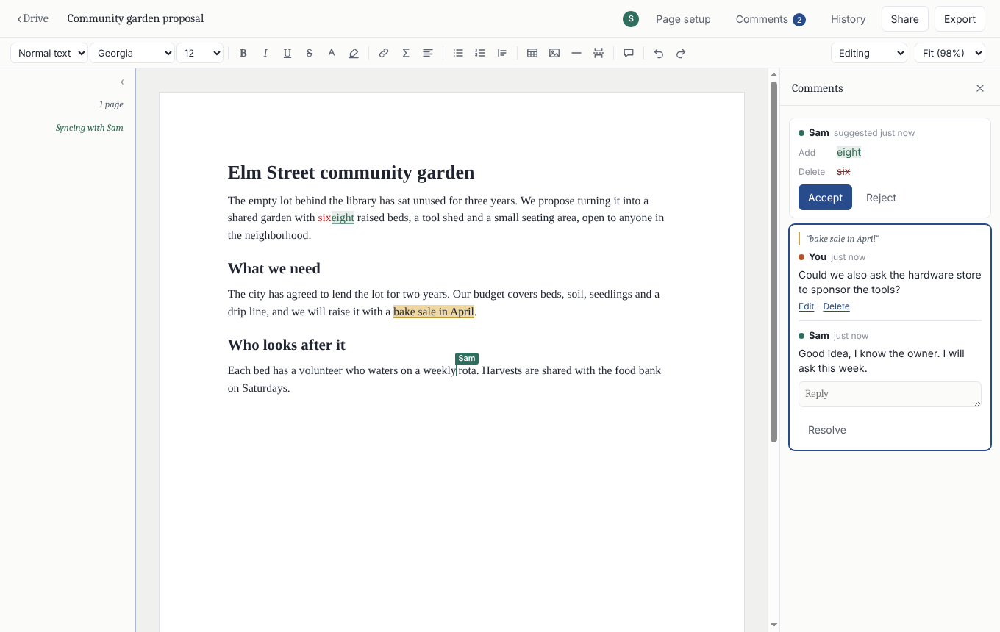

Work on the same file at the same time, see each other's cursors, leave comments, suggest edits, share with a link, and go back to any earlier version. It works the way you'd expect from an online office suite, except nobody runs it. There is no company in the middle holding your files, no sign-up, no subscription and no ads. Your files live on your computer and on the computers of the people you share them with, and travel directly between you, encrypted end to end.

- **No account.** Open the app, type your name, start working. Your identity is a key made on your computer.
- **No server.** Computers find each other on a peer-to-peer network and connect directly. Nobody can read your files in transit, sell them, lose them in a breach, or lock you out.
- **Works offline.** Edits are saved on your computer first and merge on their own when you meet again, like a git merge that resolves itself. Where two people changed the same sentence, the owner sees both and picks.
- **Any file.** Upload anything up to 100 MB. Big files, and kinds that can run code, wait for you to say yes before they take space on your computer.
- **Yours to keep.** Import and export `.docx`, `.xlsx`, `.pptx`, `.csv`, `.ics`, `.md`, `.svg`, `.png` and PDF. MIT licensed.

## The apps

**commonDrive** keeps your files: list or icons, folders, filters, search, and a history of every version.

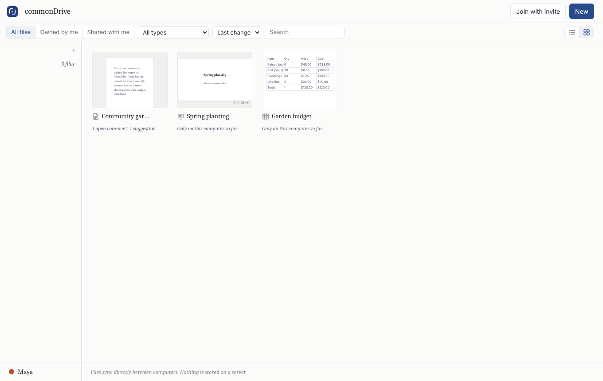

**commonDocs** has markdown documents for writing that flows, and paged documents with paper size, margins, fonts and colors. Both have links, LaTeX math, tables, images, footnotes, a table of contents that keeps itself up to date, find and replace, a word count, spell checking, comments, and a suggesting mode whose edits others accept or reject. Paged documents have headers and footers ("Page {page} of {pages}").

**commonSheets** has formulas (SUM, AVERAGE, IF, VLOOKUP, SUMIFS and more), several sheets per file, number formats and styles, sorting, frozen rows and columns, conditional formatting and color scales, dropdowns and checkboxes, charts (columns, bars, lines and pies) and summaries by group, like pivot tables. Filters change only your own view, so nobody's rows vanish under them.

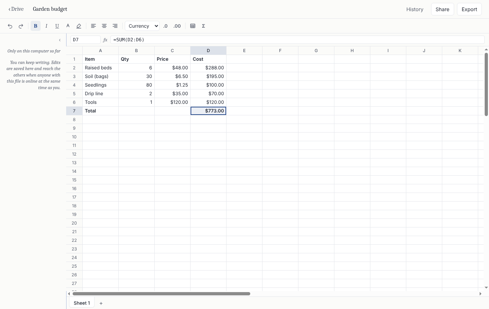

**commonSlides** has layouts, themes, text boxes, shapes, images, speaker notes, transitions and full-screen presenting. Presenter view puts the slides on a second display and keeps your notes, the next slide and a timer on yours. Imports and exports `.pptx`.

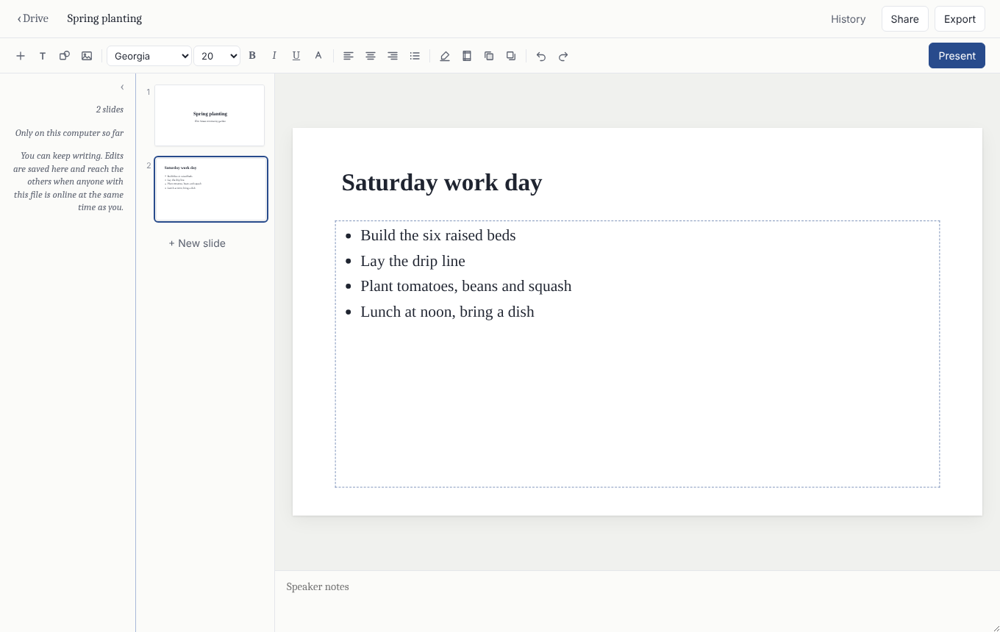

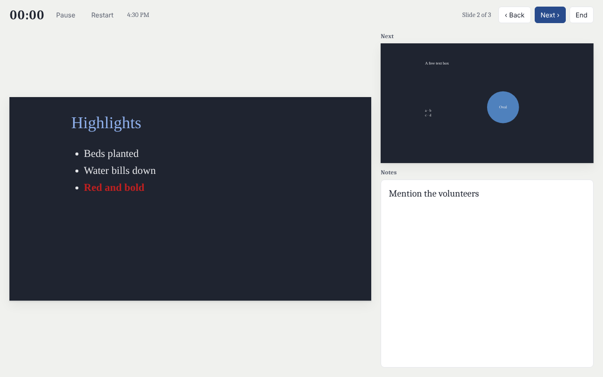

**commonTasks** is a task board: lists of cards you drag between, with due dates, notes and the person it's assigned to, as a board or a checklist. Exports `.csv` and Markdown.

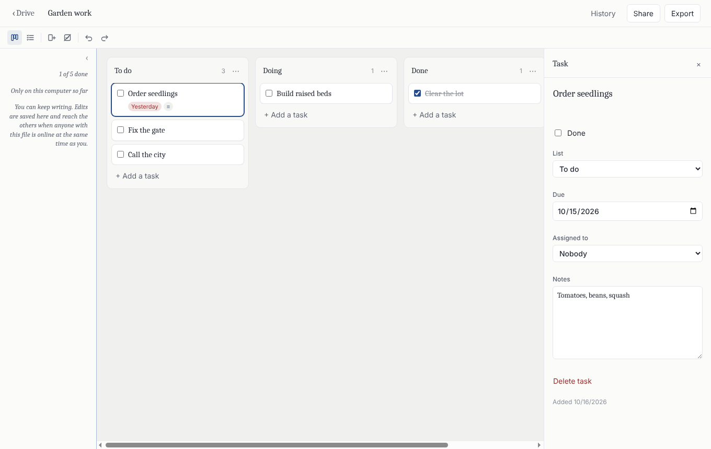

**commonCalendar** has month and week views, all-day and repeating events, reminders, and dragging events to another day. Everyone sees times in their own time zone. Imports and exports `.ics`, so events move to and from Google Calendar, Apple Calendar and Outlook.

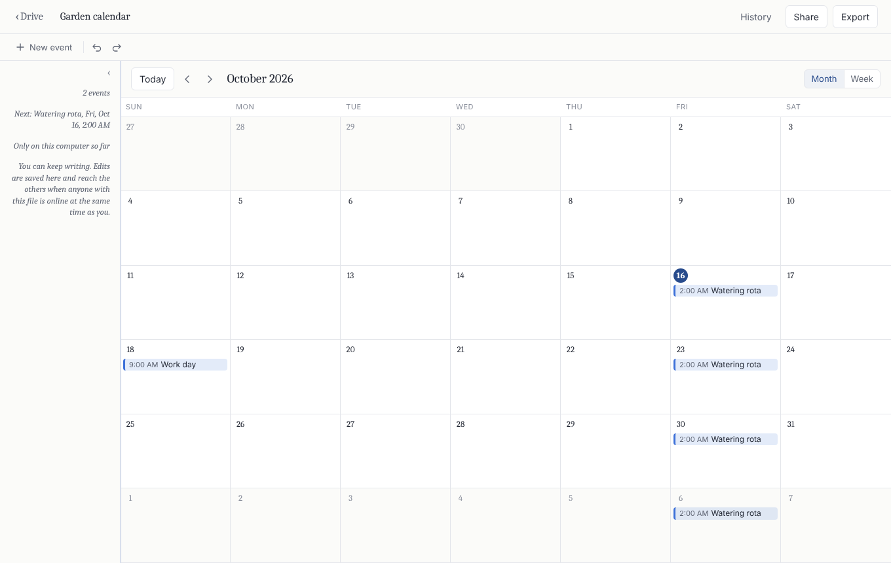

**commonBoard** is an open whiteboard: sticky notes, shapes, text, arrows and drawing, with everyone's cursor and selection live. Exports `.svg` and `.png`.

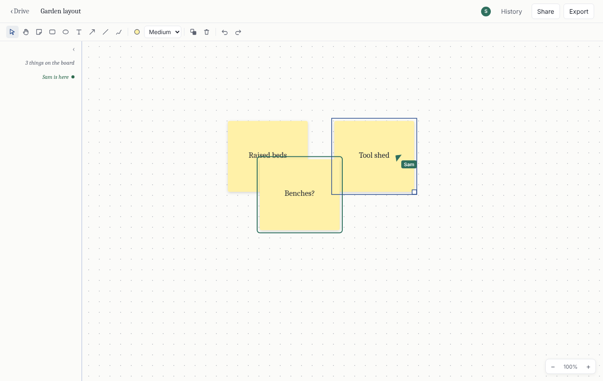

**commonForms** collects answers. Share a form with "Can answer", and each person's answers are sealed so only people who can edit the form can read them, not the other people answering. See the answers summarized or one by one, and export them as `.csv`.

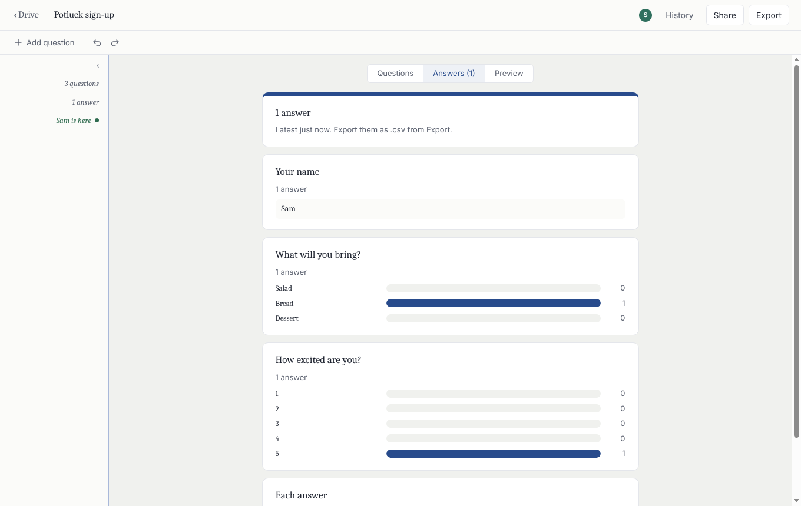

**Any other file** can be uploaded too (New → Upload files, or drag files onto the Drive), up to 100 MB each, and shared like the rest. Images, video, audio and text preview right in the app.

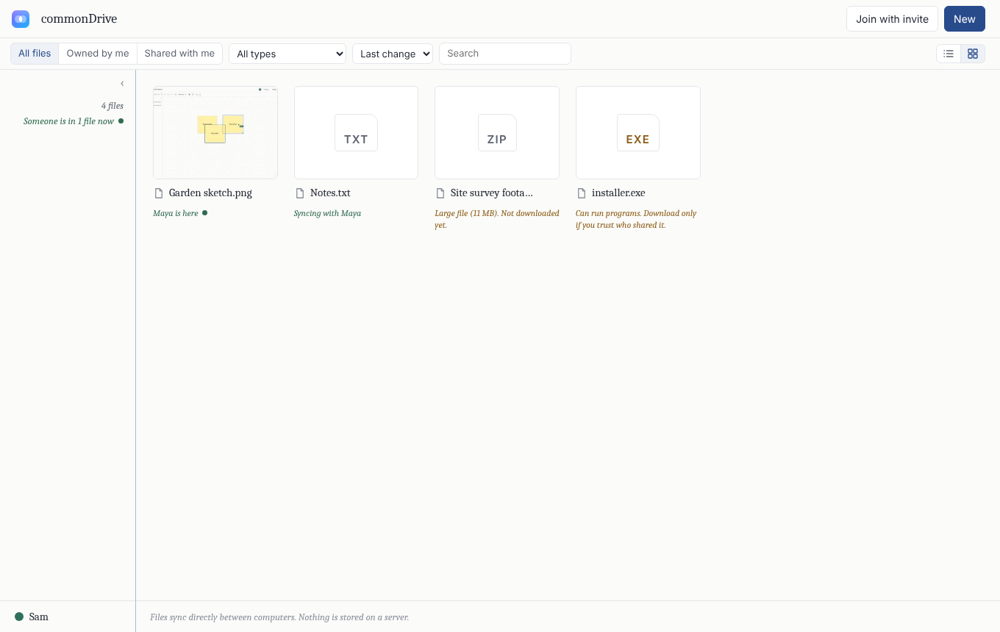

### Your disk comes first

Everything you share lives on the computers of the people you share it with, so each computer protects itself. Every limit below is a setting (your profile → **Limits and safety**), and these are the defaults:

- Files others share download by themselves only when they're small (10 MB or less). Bigger ones wait until you click **Download**, and anything over your largest-file limit (100 MB) says so first.
- Kinds of file that can run code (programs, scripts, installers, web pages, documents with macros) always wait for a yes, and are only ever saved, never opened from commonplace.
- Automatic downloads have a daily budget: 200 MB from any one person and 1 GB from everyone. After that, files wait for a yes until the next day.
- A shared folder can bring 25 files a day; more than that arrive paused, with **Sync all** to take them.
- A document someone else made pauses at 100 MB, your own pauses at 500 MB if others' edits grow it, and everything others made together is kept under 5 GB.
- Nothing from others downloads or grows when the disk is down to 2 GB free.
- A form takes up to 20 answers from one person.
- Nobody can send you a piece of a file you didn't ask for, or one whose contents don't match.
- **Storage** shows what takes space and whose files take the most, with **Block**: a blocked person's files pause, their uploads never download, and your computer stops exchanging anything with them.

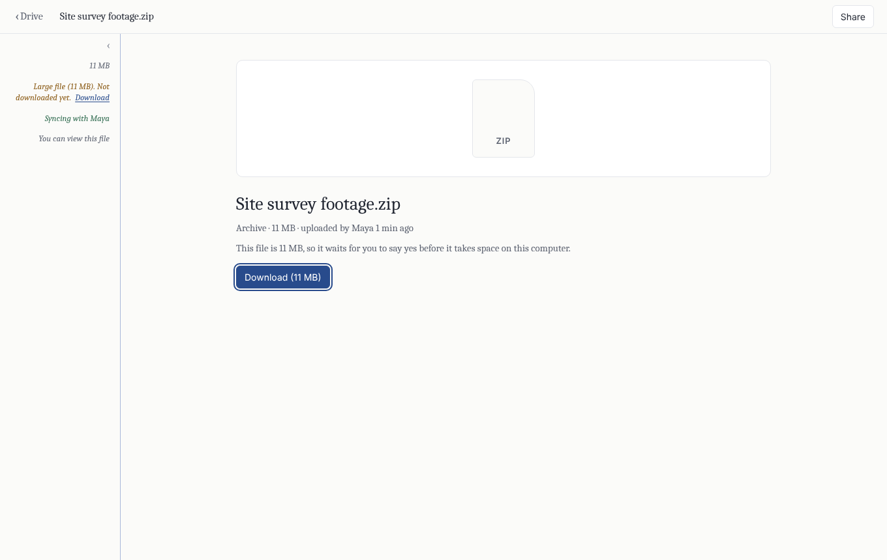

**Templates.** New → From a template has meeting notes, a project brief, a budget, shared costs, a project update deck, a moving-house board, a retrospective, an event sign-up and more, all built in and working offline. Save any file as your own template, or make a copy of it.

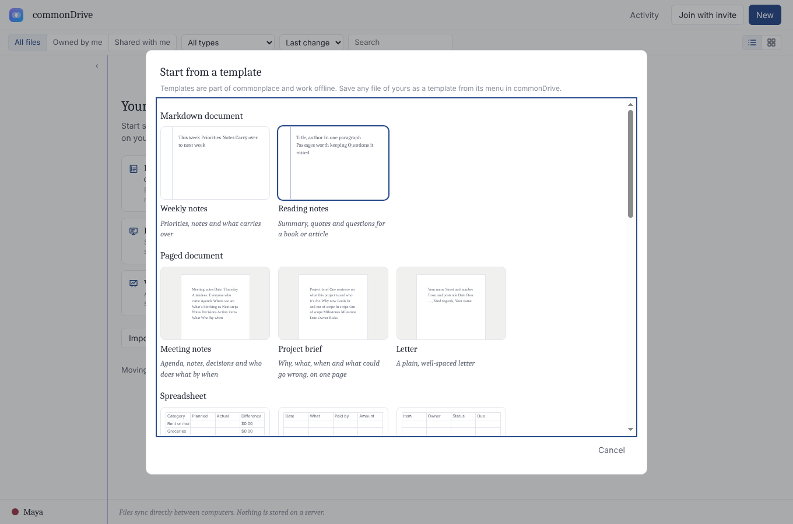

**Comments in every app.** Comment on a passage, a cell, a slide, a task, an event, a shape, a question or a whole file, reply, and resolve. Type @ to mention someone with access. **Activity** in commonDrive lists mentions, replies, comments on your files and files shared folders bring you, with a notification when you're elsewhere.

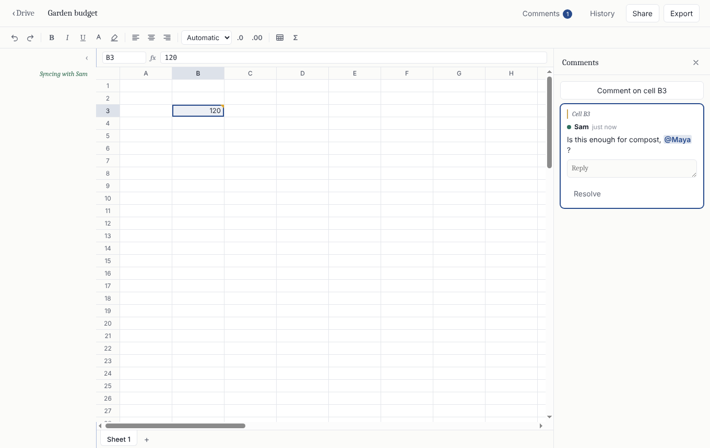

**The apps work together.** Type @ in a document to place a person, a file or a date as a chip; clicking a file opens it, and a date can go straight onto one of your calendars. Select some lines and **Send to a task board**: each line becomes a card, people in it become who it's assigned to and dates become due dates. Calendars can show the due dates from your task boards (for you only; nothing is copied). Copy a chart from commonSheets as a picture and paste it into a document or slide. Each file still keeps its own people: linking to a file never shares it.

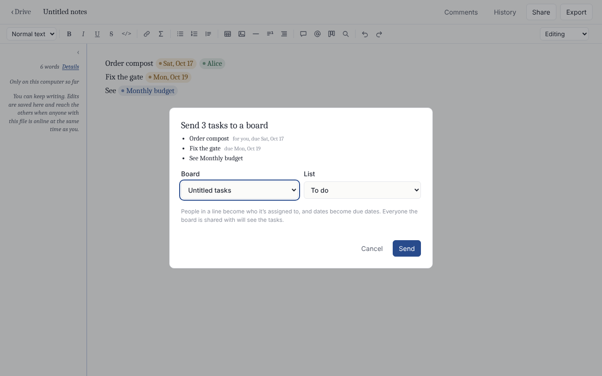

## Sharing

Invite people to edit, only view, or (for forms) answer; change their role, remove them, or hand ownership to someone else. Invite links expire (after 7 days unless you choose otherwise) and can be limited to one person or need your approval for each person.

**How long access lasts.** Each invite link, and each person in the Share dialog, can have access:

- **until you remove them** (the default);
- **until a date and time**, when it ends on its own on every computer;
- **only while you're online**, as a *guest*: they never receive the file's keys, and your computer passes changes to them only while it's running.

For the last two, you choose what happens to their copy when access ends (or, for a guest, while you're away): they keep a **read-only copy** as it was, or commonplace **removes it**. Their edits stop being accepted either way. commonplace removes its own copy as asked, but can't stop someone who saved one another way; ending access stops everything new, and that part can't be worked around. Anyone can always remove any file from their own Drive, whatever their access.

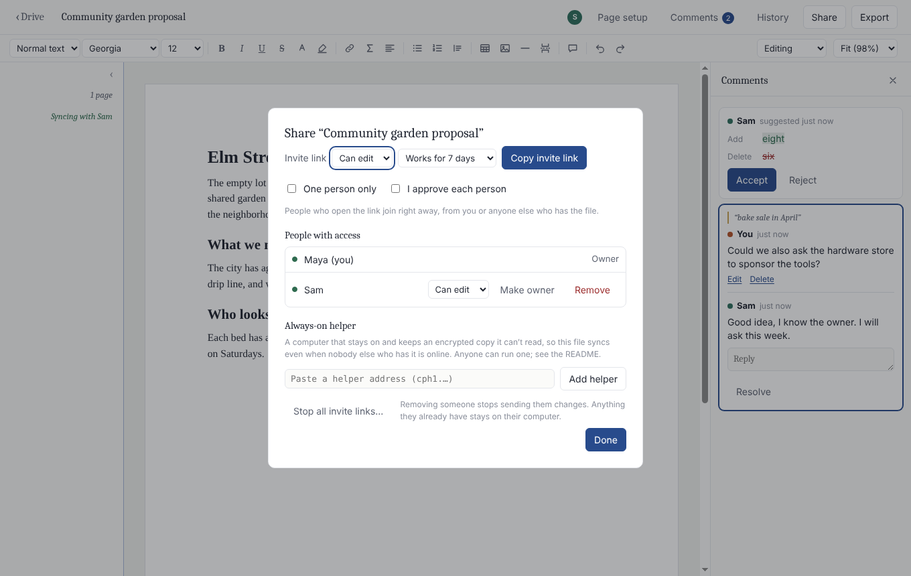

**Shared folders.** Make one with New → Shared folder, or share one of your folders (with its subfolders). Everyone in it gets everything inside: what you put there and what the others do. Folder editors can edit the files, viewers can view them and answer forms. Moving a file in shares it; moving it out, or removing someone from the folder, takes away what they had only through it. Each file's owner does the granting from their own computer whenever it runs, so nobody needs to be online at the same time.

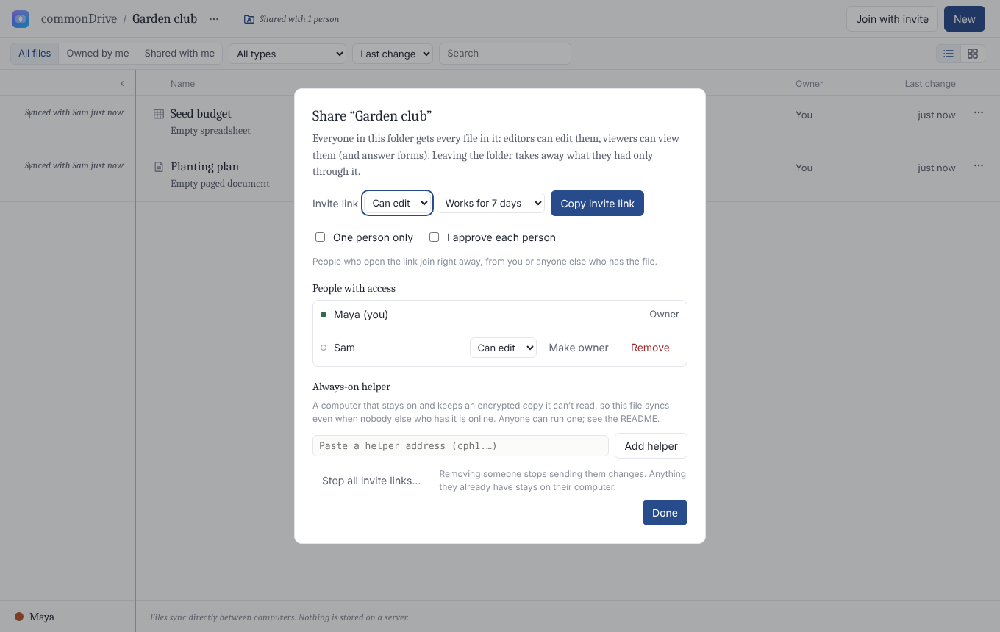

Use the same Drive on several computers: **Link another computer** in your profile keeps them in sync. Or move your Drive to a new computer.

**Recovery.** Make a backup in your profile and you get a recovery key. If you lose your computer, a new one plus the backup file and the key becomes you again, with your files. The backup stays up to date once a day.

## How it works

- Every file is a CRDT (Yjs). Copies that have seen the same edits are identical, in any order, so nobody has to be online to "own" consistency.
- Your edits are saved on your computer first. When anyone else with the file is online at the same time as you, your computers find each other on a peer-to-peer network (Hyperswarm), connect directly, and exchange what each is missing.
- Every byte that leaves your computer is encrypted with the file's key. The key travels only inside the invite link, or sealed to each member after someone is removed.
- Your identity is a keypair created on first launch. Your name and cursor color are yours to pick. Each file's owner signs who may read or edit it, and every computer checks those signatures.
- Computers on the same network find each other directly and sync without internet.

The tradeoff, chosen on purpose: changes travel only while at least one other person (or computer) that has the file is online. If you'd rather not wait for that, run an always-on relay (below). It's optional and needs nothing but a computer you leave on.

See [docs/ARCHITECTURE.md](docs/ARCHITECTURE.md) for the design and roadmap.

## Install

**Download the app.** No Git, Node.js or Terminal needed:

| | |
|---|---|
| macOS, Apple Silicon (M1 and later) | [commonplace-mac-arm64.dmg](https://github.com/HarvielArcilla/commonplace/releases/latest/download/commonplace-mac-arm64.dmg) |
| macOS, Intel | [commonplace-mac-x64.dmg](https://github.com/HarvielArcilla/commonplace/releases/latest/download/commonplace-mac-x64.dmg) |
| Windows 10 and 11 (x64 and ARM) | [commonplace-windows-setup.exe](https://github.com/HarvielArcilla/commonplace/releases/latest/download/commonplace-windows-setup.exe) |
| Linux | [commonplace-linux-x86_64.AppImage](https://github.com/HarvielArcilla/commonplace/releases/latest/download/commonplace-linux-x86_64.AppImage) |

Every version is on the [releases page](https://github.com/HarvielArcilla/commonplace/releases). The builds aren't signed with a paid developer certificate, so the first time:

- **macOS:** open the `.dmg` and drag commonplace to Applications. Open it; when macOS says it can't check the developer, open **System Settings → Privacy & Security** and choose **Open Anyway**.
- **Windows:** run the installer; if SmartScreen appears, choose **More info**, then **Run anyway**.
- **Linux:** make the AppImage executable (`chmod +x`) and run it.

When your computer asks whether commonplace may use the network, allow it (on Windows, for private networks too, for same-network sync), or other people's computers can't reach yours. The app tells you when a new version is out and links to it.

**Or install from source**, to always have the newest work on `main`. One command installs everything it needs (Git and Node.js too, if they're missing) into `commonplace` in your home folder, adds a launcher, and from then on **Update and restart** in the app updates it in place.

macOS or Linux (Terminal):

```sh
curl -fsSL https://raw.githubusercontent.com/HarvielArcilla/commonplace/main/scripts/install.sh | bash
```

Windows (PowerShell):

```powershell
powershell -ExecutionPolicy Bypass -Command "irm https://raw.githubusercontent.com/HarvielArcilla/commonplace/main/scripts/install.ps1 | iex"
```

The scripts are short and commented: read [install.sh](scripts/install.sh) or [install.ps1](scripts/install.ps1) before running them if you like. Settings: `COMMONPLACE_DIR` (install location), `COMMONPLACE_NO_SHORTCUT=1`.

Either way, the update check only asks GitHub's public API about this project's releases or commits, and sends nothing about you or your files. Turn it off in Settings → Limits and safety. Closing the window quits commonplace, and files stop syncing until you open it again.

### By hand

Requires Git and Node 20+.

```sh
git clone https://github.com/HarvielArcilla/commonplace.git
cd commonplace
npm install
npm start            # builds the window UI and starts the app
npm test             # end-to-end tests on a private local DHT
```

On Windows, if PowerShell says running scripts is disabled, use `npm.cmd install` and `npm.cmd start`.

To try collaboration on one computer, start a second copy with its own identity and files:

```sh
COMMONPLACE_PROFILE=bob npm start                 # macOS / Linux
$env:COMMONPLACE_PROFILE="bob"; npm.cmd start     # Windows PowerShell
```

Create a document in one window, open **Share**, copy an invite link, and paste it into **Join with invite** in the other.

To run on a private network instead of the public DHT, set `COMMONPLACE_BOOTSTRAP=host:port` (and optionally `COMMONPLACE_DHT_HOST`).

## Always-on relay (optional)

A relay is a small program you leave running on any computer that stays on: an old laptop, a Raspberry Pi, a free cloud VM. It keeps encrypted copies of files it can't read, so people who are never online at the same time still sync, and it passes changes along live when two computers can't reach each other directly. It can't forge edits either: every change is signed by the person who made it and checked against the file's members.

```sh
npm run relay                     # from a clone of this repo, or:
node packages/relay/bin/commonplace-relay.js --dir ~/relay-data --quota 4
```

It prints an address starting with `cpr1.`. Paste it into your profile in commonplace (used for new files and to sync your own computers), or into a file's **Share** dialog. Everyone working on that file then uses it.

## Build installers

```sh
npm run dist:mac -w @commonplace/desktop     # .dmg and .zip, Apple Silicon and Intel (run on a Mac)
npm run dist:win -w @commonplace/desktop     # one .exe installer for x64 and ARM64 (run on Windows)
npm run dist:linux -w @commonplace/desktop   # .AppImage
```

GitHub Actions (`.github/workflows/build.yml`) runs the tests and builds all three on every push to `main`. Pushing a version tag (`git tag v0.2.0 && git push origin v0.2.0`) also publishes them as a GitHub release, which is where the Download links and the installed app's update check look.

Builds aren't signed with paid certificates. The macOS app is signed ad hoc (Apple Silicon won't run an app with no signature at all), so macOS asks you to approve it once rather than calling it damaged.

## Layout

```
packages/core    identity, encryption, storage, sync engine, P2P transport
packages/drive   commonDrive: the file index, background syncing, history, linked computers
packages/docs    commonDocs: the app descriptor, rich-text editor, comments and suggestions
packages/sheets  commonSheets: workbook model, formula engine, .xlsx and .csv
packages/slides  commonSlides: deck model, text-box editor, .pptx import and export
packages/tasks   commonTasks: lists and cards, .csv and Markdown
packages/calendar commonCalendar: events, repeats, .ics
packages/whiteboard commonBoard: shapes, drawing them as SVG
packages/forms   commonForms: questions, sealed answers, .csv
packages/relay  the optional always-on relay
apps/desktop     Electron shell (background process + window UI)
scripts/         one-step installers and launchers
test/            end-to-end sync, access, conflict, history, relay, recovery and app tests
```

## License

MIT. See [LICENSE](LICENSE).
